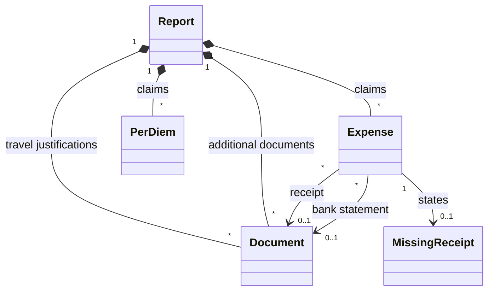

# Domain Model

The concepts an expense report is made of, and how they relate. The
Claimant fills them in step by step, the draft keeps them between two
sessions, and the report document is written from them. A PDF or an image is
a format at the edge of the system, never the thing the system reasons about.

This file is also the **glossary**: a term below means one thing, everywhere,
in the specification, in the interface, in the code and in the report
document.

## Concepts

| Concept | Meaning |
|---|---|
| Claimant | The person asking to be reimbursed, and the only user of the system. |
| Report | What the Claimant prepares: the claimant's name, position and email, the supervisor of a student or a postdoctoral fellow, or the host of a visitor, the purpose, its dates and its locations, the account, the expenses, the per diems, the travel justifications and the additional documents. There is one report at a time. |
| Position | What the claimant is at McSCert: Faculty, Postdoctoral fellow, Student, Staff or Visitor. The report of a student or a postdoctoral fellow names their supervisor, a visitor's their host. |
| Supervisor | The faculty member who supervises a student or postdoctoral fellow claimant, named in the report by their name and email. |
| Host | The McSCert member who hosts a visiting claimant, named in the report by their name and email. |
| Purpose | What the expenses were made for, in the Claimant's words: a conference, a workshop, a visit, equipment. A report is not necessarily for an event. |
| Business travel | A report whose purpose took the claimant away from McMaster: a conference, a visit. Only a business travel has dates, locations, per diems and travel justifications. |
| Dates | The first and the last day of a business travel. One day when they are the same. |
| Locations | Where a business travel took the claimant, in the Claimant's words: Paris, France; Lyon, France. |
| Account | The account the Claimant suggests the expenses be charged to: its name, as free text, and its code when the Claimant gives it. |
| Expense | One transaction claimed: its date, its description, its claimed amount, its foreign amount when it was paid in another currency, its receipt or the reason it has none, and its bank statement unless it was paid in cash. |
| Description | What the expense was for, in the Claimant's words. For a meal not only for the Claimant, it lists the attendees and their affiliations. The system never checks what a description says. |
| Claimed amount | The amount in Canadian dollars asked back for an expense, more than zero, to the cent. An expense paid in another currency may have none: McSCert then works it out from the foreign amount. |
| Foreign amount | The amount and currency of an expense paid in another currency than the Canadian dollar, as on its receipt: more than zero, to the cent. The system converts nothing and asks for no exchange rate. |
| Currency | A currency other than the Canadian dollar, by its three-letter ISO 4217 code and its name in English: EUR, Euro. |
| Itemized expenses | The expenses of a report apart from its per diems, as the Expenses and Review steps title them. |
| Expense preset | Expenses the system adds to a report together, named and configured in `config/expense-presets.json`, offered to a business travel or to another report. An expense added from a preset is like any other, and remembers only the name of its preset. A preset gives no document, and says nothing of how an expense was paid. |
| Once per report | What the table of expense presets says of a preset that is not offered to a report while it holds an expense added from it: the travel presets are; a monthly subscription, added once per subscription, is not. |
| Preset parameter | What an expense preset asks of the Claimant before adding its expenses: a text, a date, a month, an amount or a foreign amount. |
| Per diem | What a business travel claims for the meals of one of its days, at their rates rather than on receipts: each meal domestic or international, the meals claimed, and, for a meal not claimed, the reason when the Claimant gives one. A business travel has one per day, from its first day to its last. |
| Meal | Breakfast, lunch or dinner, the three meals of a per diem. |
| Domestic, international | What the Claimant says a meal of a per diem is. It decides the currency of its rate: the Canadian dollar for a domestic meal, the US dollar for an international one. The meals of a day, and of a business travel, are most often all one or all the other. |
| Rate | What a meal claimed is worth, in Canadian dollars for a domestic meal, in US dollars for an international one. The rates are configured, one for each meal and each of domestic and international, in `config/per-diems.json`: today breakfast 28.40, lunch 27.40 and dinner 57.70, either way. |
| Total | What the report claims: the sum of the claimed amounts and of the domestic meals claimed, then, for each currency, the sum of the foreign amounts of the expenses without a claimed amount, and, in US dollars, of the international meals claimed. |
| Paid in cash | An expense paid in cash has no bank statement. Any other expense was paid by card or transfer and has one. |
| Missing receipt | An expense whose Claimant has no receipt. It states the reason, who was paid and the job title, and the phone extension when the Claimant gives one; the system writes a missing receipt authorization for it. |
| Paid to | Who was paid for an expense with a missing receipt, in the Claimant's words: its payee, as the section of missing receipt authorizations heads it. |
| Job title | What the claimant's job is called, in the Claimant's words, given with each missing receipt and written under *Title* on its missing receipt authorization: Associate Prof, Research Engineer, PhD Student. |
| Phone extension | The claimant's telephone extension, given or not with each missing receipt, and written under *Extension* on its missing receipt authorization. |
| Accounts Payable | The McMaster office that reimburses. It may not accept a missing receipt authorization, and may return the report. |
| Take back | The Claimant goes back on a missing receipt or on an expense paid in cash: the expense asks for its receipt or its bank statement again. |
| Document | A file the Claimant adds to the report: a PDF, a JPEG image or a PNG image, of one kind, with a name. A document is in the report once, whatever the number of expenses that refer to it. |
| Name | What a document is called in the report and in the report document: its file name without its extension, unless the Claimant gives it another. No two documents of a report have the same name, whatever its case. |
| Kind | What a document is, among the kinds of the table below. The kind decides the section a document goes to and the letter of its label. |
| Receipt | A document an expense refers to: an invoice or an official receipt; for air tickets, the booking information. Added from an expense, or chosen among the receipts already in the report. |
| Bank statement | A document an expense refers to: a bank or credit card statement showing the charge. Added from an expense, or chosen among the bank statements already in the report: one often supports several expenses. The Claimant redacts it, before adding it or in the saved report document; the system does not redact. |
| Additional document | A document of the report as a whole, which no expense refers to: a travel justification, an itinerary, a poster, boarding passes, notes. |
| Travel justification | An additional document of a business travel that justifies the travel: an invitation letter, a conference programme, an acceptance notification. A business travel has at least one. |
| Missing receipt authorization | McMaster's Missing Receipt Authorization Form, written by the system for one expense with a missing receipt, filled in with what the report knows, and left for the Claimant to sign. It is not a file the Claimant adds. |
| Label | The name of a document in the report document: the letter of its kind and its rank within its section, as in R3. |
| Add | The Claimant hands a file to the system, which reads it in the browser, on their computer. Nothing is sent over a network. |
| Unlock | What the system does of a PDF that opens without a password, though one restricts printing or copying it: it reads it, says so, and the report document holds it without that restriction. |
| Refuse | The system does not take a file the Claimant adds, and says why: of another format, damaged, a PDF without pages, a PDF that needs a password to open, or already a document it cannot choose. |
| Remove | The Claimant takes an expense, a document or a document's use by an expense out of the report. A receipt or a bank statement no expense refers to any more leaves the report. |
| Heavy | What a document is above the size configured in `config/document-sizes.json`, today 2 MB: by the size it is written at: that of the file added, a JPEG without its Exif data, or of its reduced file once reduced. |
| Reduce | The Claimant asks the system to make a heavy document smaller: its images written with fewer pixels and, for a PDF document that is not a bank statement, each shape it draws repeatedly kept once. The pages, text, links and form fields of a PDF document stay as they are. Nothing is reduced unless the Claimant asks. |
| Original | The file the Claimant added, as the Review step calls it next to the reduced file of a document. |
| Restore | The Claimant takes back reducing a document: the report document holds the file added again. |
| Draft | The report as the Claimant left it, kept by the browser on their computer so that closing the page loses nothing. Keeping it is best effort. |
| New report | Discarding the draft, its expenses and its documents, to start another report for the same claimant: their name, position and email, and the supervisor of a student or a postdoctoral fellow or the host of a visitor, are kept. |
| Finding | Something that stands between the draft and its report document, worded for the Claimant: a missing field, an expense without a bank statement, a character the report document cannot write. A draft with a finding cannot be saved as a report document. |
| Report document | The single PDF the system writes from a report without findings: the cover, then one section per kind of document. It is the only thing that counts once the report is done. |
| Layout | What the report document holds, worked out from a report without findings: the fields of the cover, the expenses and the per diems numbered with their total, the sections in order, and each document with its label and the expenses it supports. How it falls into pages is left to the writing. |
| Save | The system hands the report document to the browser, which writes it on the Claimant's computer. The document is built in the browser: nothing is fetched or sent over a network. |
| Cover | The first page or pages of the report document, which take the place of the McSCert Expense Report Template: the report's fields, the attached information, the table of the expenses and the per diems, and their total. |
| Entered | The box of an expense or a per diem on the cover, left empty by the system, that McSCert's administrative staff tick once they have entered the expense in Mosaic. |
| Policy | The documents setting the rules of reimbursement, as `config/policy.json` lists them, each a name and an address: linked from the report document and from the footer of the interface, never copied. |
| Mosaic | The system McSCert's administrative staff enter the expenses in. |
| Section | The part of the report document holding the documents of one kind, opened by its section pages. |
| Section page | A page that opens a section: its title and the list of its documents, each with its label, its name, its pages and the expenses it supports, by their description. The list continues on as many section pages as it needs. |
| Stamp | The line written in the margin of every page of the report document: the label of the document the page belongs to, when it belongs to one, the name of an additional document, the expenses that document supports, each by its number and the start of its description, and the page number out of the total. |
| Link | A label, a document on the cover or an expense in the report document that a reader clicks, on screen, to go to the document's first page, the document's row on its section page or the expense's row on the cover. An arrow after it shows that it is one. |

### Kinds of document

| Kind | Letter | Where it comes from |
|---|---|---|
| Additional document | A | Added by the Claimant to the report, travel justifications among them |
| Receipt | R | Added by the Claimant from an expense |
| Missing receipt authorization | M | Written by the system, one per expense with a missing receipt |
| Bank statement | S | Added by the Claimant from an expense |

The order of this table is the order of the sections in the report document.

## Relations

- An expense has one receipt, or a missing receipt; never both.
- An expense not paid in cash has one bank statement; an expense paid in
  cash has none.
- A receipt or a bank statement belongs to the report while an expense refers
  to it. One bank statement often supports every expense of a trip.
- A business travel has at least one travel justification; another report has
  none.
- Travel justifications and additional documents belong to the report, not to
  an expense.
- A business travel has one per diem per day, from its first day to its last;
  another report has none. A per diem claims each meal once at most, and is
  supported by no document.
- A per diem without a meal claimed claims nothing: the report document
  leaves it out.
