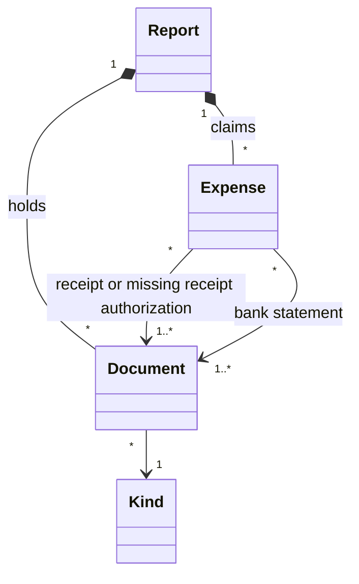

# Domain Model

The concepts an expense report is made of, and how they are linked. The
Claimant fills them in step by step, the draft keeps them between two
sessions, and the report document is written from them. A PDF or an image is
a format at the edge of the system, never the thing the system reasons about.

This file is also the **glossary**: a term below means one thing, everywhere,
in the specification, in the interface, in the code and in the report
document.

## Concepts

| Concept | Meaning |
|---|---|
| Claimant | The person asking to be reimbursed, and the only user of the system. |
| Report | What the Claimant prepares: the claimant's name and position, the event, the dates of the event, the suggested accounts, the documents and the expenses. There is one report at a time. |
| Event | What the expenses were made for, in the Claimant's words: a conference, a workshop, a visit. |
| Dates of the event | The first and the last day of the event. One day when they are the same. |
| Account | An account the Claimant suggests the expenses be charged to, as free text. A report suggests none, one or several. |
| Expense | One transaction claimed: its date, its description, its claimed amount, its foreign amount when it was paid in another currency, and the supporting documents it refers to. |
| Description | What the expense was for, in the Claimant's words. For a meal not only for the Claimant, it lists the attendees and their affiliations. The system never checks what a description says. |
| Claimed amount | The amount in Canadian dollars asked back for an expense, as charged on the bank statement. Always more than zero, to the cent. |
| Foreign amount | The amount and currency of an expense paid in another currency than the Canadian dollar, as on its receipt. No exchange rate is asked: the bank statement supports the claimed amount. |
| Document | A file the Claimant adds to the report: a PDF, a JPEG image or a PNG image, of one kind. A document is in the report once, whatever the number of expenses that refer to it. |
| Kind | What a document is, among the six kinds of the table below. The kind decides the section a document goes to and the letter of its label. |
| Supporting document | A receipt, a missing receipt authorization or a bank statement: a document an expense refers to. |
| Label | The name of a document in the report document: the letter of its kind and its rank within its section, as in R3. Labels are given when the report document is written, in the order of its sections. |
| Add | The Claimant hands a file to the system, which reads it in the browser, on their computer. Nothing is sent over a network. |
| Remove | The Claimant takes a document or an expense out of the report. |
| Draft | The report as the Claimant left it, kept by the browser on their computer so that closing the page loses nothing. Keeping it is best effort. |
| New report | Discarding the draft, its documents and its expenses, to start another report. |
| Finding | Something that stands between the draft and its report document, worded for the Claimant: a missing field, an expense without a receipt, a document no expense refers to. A draft with a finding cannot be saved as a report document. |
| Report document | The single PDF the system writes from a report without findings: the cover, then one section per kind of document. It is the only thing that counts once the report is done. |
| Save | The system hands the report document to the browser, which writes it on the Claimant's computer. The document is built in the browser: nothing is fetched or sent over a network. |
| Cover | The first page or pages of the report document, which take the place of the McSCert Expense Report Template: the report's fields, the attached information, the table of the expenses and their total. |
| Section | The part of the report document holding the documents of one kind, opened by its section page. |
| Section page | The page that opens a section: its title and the list of its documents, each with its label, its pages and the expenses it supports. |
| Stamp | The line written in the margin of every page of the report document: the label of the document the page belongs to, when it belongs to one, and the page number out of the total. |

### Kinds of document

| Kind | Letter | What it holds | Referred to by expenses |
|---|---|---|---|
| Event document | E | Invitation, conference confirmation, itinerary, poster | No |
| Receipt | R | An invoice or an official receipt; for air tickets, the booking information | Yes |
| Missing receipt authorization | M | McMaster's Missing Receipt Authorization Form, filled in and signed by the Claimant, standing for a receipt or a boarding pass that is missing | Yes |
| Boarding pass | B | Boarding passes, departure and return slips | No |
| Bank statement | S | A bank or credit card statement showing the charge, redacted by the Claimant beforehand | Yes |
| Note | N | Additional pages of notes or explanations | No |

The order of this table is the order of the sections in the report document.

## Links

- A report holds its documents and its expenses; removing a document removes
  it from every expense that refers to it.
- An expense refers to at least one receipt or missing receipt authorization,
  and to at least one bank statement. A document may support several
  expenses: one bank statement often shows every charge of a trip.
- Event documents, boarding passes and notes belong to the report, not to an
  expense.
