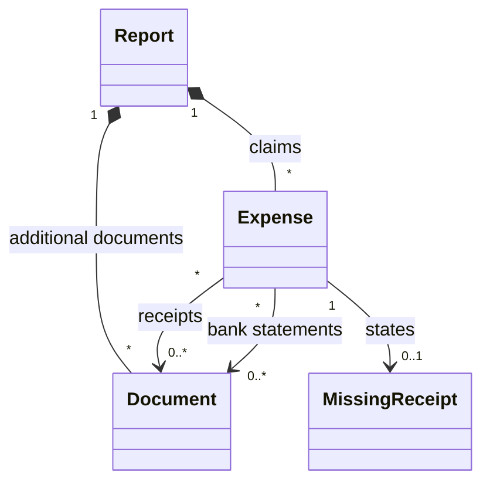

# Domain Model

The concepts an expense report is made of, and how they are linked. The
Claimant fills them in step by step, the draft keeps them between two
sessions, and the report document is written from them. A PDF or an image is
a format at the edge of the system, never the thing the system reasons about.

This file is also the **glossary**: a term below means one thing, everywhere,
in the specification, in the interface, in the code and in the report
document.

## Concepts

| Concept | Meaning |
|---|---|
| Claimant | The person asking to be reimbursed, and the only user of the system. |
| Report | What the Claimant prepares: the claimant's name, position, email and extension, the event, the dates of the event, the account, the expenses and the additional documents. There is one report at a time. |
| Event | What the expenses were made for, in the Claimant's words: a conference, a workshop, a visit. |
| Dates of the event | The first and the last day of the event. One day when they are the same. |
| Account | The account the Claimant suggests the expenses be charged to, as free text. |
| Expense | One transaction claimed: its date, its description, its claimed amount, its foreign amount when it was paid in another currency, its receipts or the reason it has none, and its bank statements unless it was paid in cash. |
| Description | What the expense was for, in the Claimant's words. For a meal not only for the Claimant, it lists the attendees and their affiliations. The system never checks what a description says. |
| Claimed amount | The amount in Canadian dollars asked back for an expense. Always more than zero, to the cent. |
| Foreign amount | The amount and currency of an expense paid in another currency than the Canadian dollar, as on its receipt, shown for information. The system converts nothing and asks for no exchange rate. |
| Paid in cash | An expense paid in cash has no bank statement. Any other expense was paid by card or transfer and has at least one. |
| Missing receipt | An expense whose Claimant has no receipt. It states the reason and who was paid; the system writes a missing receipt authorization for it. |
| Document | A file the Claimant adds to the report: a PDF, a JPEG image or a PNG image, of one kind. A document is in the report once, whatever the number of expenses that refer to it. |
| Kind | What a document is, among the kinds of the table below. The kind decides the section a document goes to and the letter of its label. |
| Receipt | A document an expense refers to: an invoice or an official receipt; for air tickets, the booking information. Added from an expense. |
| Bank statement | A document an expense refers to: a bank or credit card statement showing the charge. Added from an expense, and often referred to by several. The Claimant redacts it, before adding it or in the saved report document; the system does not redact. |
| Additional document | A document of the report as a whole, which no expense refers to: an invitation letter, a conference confirmation, an itinerary, a poster, boarding passes, notes. |
| Missing receipt authorization | McMaster's Missing Receipt Authorization Form, written by the system for one expense with a missing receipt, filled in with what the report knows, and left for the Claimant to sign. It is not a file the Claimant adds. |
| Label | The name of a document in the report document: the letter of its kind and its rank within its section, as in R3. |
| Add | The Claimant hands a file to the system, which reads it in the browser, on their computer. Nothing is sent over a network. |
| Remove | The Claimant takes an expense, a document or a document's use by an expense out of the report. A receipt or a bank statement no expense refers to any more leaves the report. |
| Draft | The report as the Claimant left it, kept by the browser on their computer so that closing the page loses nothing. Keeping it is best effort. |
| New report | Discarding the draft, its expenses and its documents, to start another report. |
| Finding | Something that stands between the draft and its report document, worded for the Claimant: a missing field, an expense without a bank statement, a character the report document cannot write. A draft with a finding cannot be saved as a report document. |
| Report document | The single PDF the system writes from a report without findings: the cover, then one section per kind of document. It is the only thing that counts once the report is done. |
| Save | The system hands the report document to the browser, which writes it on the Claimant's computer. The document is built in the browser: nothing is fetched or sent over a network. |
| Cover | The first page or pages of the report document, which take the place of the McSCert Expense Report Template: the report's fields, the attached information, the table of the expenses and their total. |
| Section | The part of the report document holding the documents of one kind, opened by its section page. |
| Section page | The page that opens a section: its title and the list of its documents, each with its label, its pages and the expenses it supports. |
| Stamp | The line written in the margin of every page of the report document: the label of the document the page belongs to, when it belongs to one, and the page number out of the total. |

### Kinds of document

| Kind | Letter | Where it comes from |
|---|---|---|
| Receipt | R | Added by the Claimant from an expense |
| Missing receipt authorization | M | Written by the system, one per expense with a missing receipt |
| Bank statement | S | Added by the Claimant from an expense |
| Additional document | A | Added by the Claimant to the report |

The order of this table is the order of the sections in the report document.

## Links

- An expense has at least one receipt, or a missing receipt; never both.
- An expense not paid in cash has at least one bank statement; an expense paid
  in cash has none.
- A receipt or a bank statement belongs to the report while an expense refers
  to it. One bank statement often supports every expense of a trip.
- Additional documents belong to the report, not to an expense.
